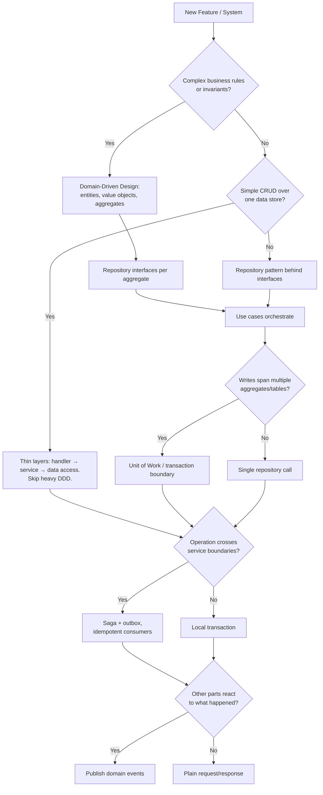

# Software Architecture

Production-ready architecture patterns that work in any language: Clean/Hexagonal Architecture, Domain-Driven Design, and the distributed-systems patterns that keep real systems reliable at scale.

The patterns here are deliberately written in **neutral pseudocode**. Your job is to apply the *ideas* in the idioms of whatever stack the user is actually using — a Go service should look like idiomatic Go, a Rust crate like idiomatic Rust, a Spring app like idiomatic Spring. Transliterating pseudocode (or another language's style) line by line produces code that fights its ecosystem; translating the intent produces code the team will want to maintain.

## How to Use This Skill

1. **Identify the stack first.** Look at the repository (manifest files such as `package.json`, `go.mod`, `Cargo.toml`, `pom.xml`/`build.gradle`, `*.csproj`, `pyproject.toml`, `composer.json`, `Gemfile`, `mix.exs`, `pubspec.yaml`, `Package.swift`) or ask. Note the language, framework, and existing conventions — existing project conventions beat the defaults in this skill.
2. **Right-size the architecture.** Use the decision guide below. A CRUD admin tool does not need aggregates and sagas; a payments platform probably does. Over-engineering is as real a failure as under-engineering.
3. **Read only the references you need** from the table below.
4. **Translate to the target language** using [language-adaptation.md](references/language-adaptation.md) — it maps every concept here (interfaces, DI, errors, immutability, async, generics) onto each major language's idioms and lists the usual libraries per ecosystem.
5. **Explain the trade-offs** you chose so the user can push back.

## Quick Reference

| Need to...                                  | See Reference                                                   |
| ------------------------------------------- | --------------------------------------------------------------- |
| Translate a pattern to a specific language  | [language-adaptation.md](references/language-adaptation.md)     |
| Structure a new project                     | [project-structure.md](references/project-structure.md)         |
| Follow code standards, naming, error design | [code-style.md](references/code-style.md)                       |
| Implement DI, Repository, Unit of Work      | [architecture-patterns.md](references/architecture-patterns.md) |
| Design entities, value objects, aggregates  | [domain-driven-design.md](references/domain-driven-design.md)   |
| Design HTTP/gRPC/GraphQL APIs               | [api-design.md](references/api-design.md)                       |
| Model data, queries, migrations             | [database-patterns.md](references/database-patterns.md)         |
| Implement caching                           | [caching.md](references/caching.md)                             |
| Handle events, outbox, sagas                | [event-driven.md](references/event-driven.md)                   |
| Build and connect microservices             | [microservices.md](references/microservices.md)                 |
| Architect a web, mobile, or desktop client  | [client-applications.md](references/client-applications.md)     |
| Secure the application                      | [security.md](references/security.md)                           |
| Add logging, metrics, tracing, health checks| [observability.md](references/observability.md)                 |
| Write tests                                 | [testing.md](references/testing.md)                             |
| Deploy to production                        | [deployment.md](references/deployment.md)                       |

---

## Pseudocode Conventions

All examples in this skill use the same small pseudocode so they read consistently:

```
interface UserRepository {          // an abstraction / port (interface, trait, protocol, abstract class)
  getById(id: UserId) -> User?      // `T?` = value may be absent (null, Option, Maybe, nil)
  save(user: User) -> User
}

class GetUserUseCase(users: UserRepository) {   // constructor parameters = injected dependencies
  execute(id: UserId) -> UserDTO {
    user = users.getById(id)
    if user is none: fail NotFound("User", id)  // `fail` = throw/raise OR return an error value
    return UserDTO.from(user)
  }
}
```

- **`fail X`** means "signal error X" — throw an exception in Java/C#/Python/TS/PHP/Ruby; return `Err(X)` in Rust; return `(zero, err)` in Go; return `{:error, x}` in Elixir. Pick whichever is idiomatic.
- **I/O calls are written as plain calls.** In the target language make them async/non-blocking where that's the norm (`async/await` in TS/C#/Python/Rust/Swift/Dart, coroutines in Kotlin, goroutines in Go, processes in Elixir, virtual threads in modern Java).
- **`record`** means an immutable data type (record, data class, frozen dataclass, struct with no setters, `readonly` type).
- **`transaction { ... }`** means a scoped unit of work that commits on success and rolls back on failure (try/finally, `using`, `defer`, `with`, RAII, a closure-based helper).

---

## Core Principles

### Architecture Layers

```
┌─────────────────────────────────────────────┐
│           Presentation / Interface          │  ← HTTP/gRPC handlers, CLI, UI, message consumers
├─────────────────────────────────────────────┤
│           Application                       │  ← Use cases, DTOs, ports (interfaces)
├─────────────────────────────────────────────┤
│             Domain                          │  ← Entities, value objects, domain events, rules
├─────────────────────────────────────────────┤
│          Infrastructure / Adapters          │  ← DB, cache, messaging, external APIs, file storage
└─────────────────────────────────────────────┘
```

**Dependency Rule**: source-code dependencies point inward. The domain knows nothing about frameworks, databases, or transport. Infrastructure *implements* interfaces declared by the application/domain layer (this is the "ports and adapters" / hexagonal idea). This is what makes business logic testable without a database and lets you swap a framework without rewriting rules.

The same layering applies to client apps (UI → view-model/presenter → use cases → repositories/data sources) — see [client-applications.md](references/client-applications.md).

### Key Principles

1. **Depend on abstractions at boundaries** — inject collaborators instead of constructing them, so they can be replaced in tests and swapped in production. Don't add an interface for something that will only ever have one implementation and isn't a boundary.
2. **Single responsibility** — one reason to change per module/type/function.
3. **Explicit over implicit** — no hidden globals, service locators, or magic that makes control flow hard to follow.
4. **Make illegal states unrepresentable** — use the type system (value objects, enums/sum types, non-nullable types) to push validation to the edges.
5. **Explicit types at public boundaries** — fully typed in statically typed languages; type hints/JSDoc/annotations in dynamic ones.
6. **Prefer immutability** — especially for value objects, DTOs, events, and configuration.
7. **Never block on I/O where the runtime expects non-blocking** — follow the concurrency model of the platform.
8. **Guard clauses over nesting** — validate and return early.
9. **Follow the ecosystem** — idiomatic naming, layout, error handling, and tooling for the target language trump any convention shown here.

---

## Architecture Decision Guide



**Monolith vs. microservices**: start with a well-modularised monolith (clear module boundaries, no cross-module database access). Extract a service only when a module has a genuinely different scaling, deployment cadence, team ownership, or reliability requirement. See [project-structure.md](references/project-structure.md#when-to-use-each).

---

## Common Patterns Summary

### Domain Layer

- **Entities**: identity + lifecycle; equal by ID. See [domain-driven-design.md](references/domain-driven-design.md#entities)
- **Value Objects**: immutable, equal by value, self-validating. See [domain-driven-design.md](references/domain-driven-design.md#value-objects)
- **Aggregates**: consistency boundaries with a single root. See [domain-driven-design.md](references/domain-driven-design.md#aggregates)
- **Domain Events**: facts about what happened. See [domain-driven-design.md](references/domain-driven-design.md#domain-events)

### Application Layer

- **Use Cases / Application Services**: orchestrate one operation; no business rules, no framework types
- **DTOs / Commands / Queries**: plain data crossing layer boundaries
- **Ports**: interfaces the infrastructure implements

### Infrastructure Layer

- **Repositories**: persistence behind an interface. See [architecture-patterns.md](references/architecture-patterns.md#repository-pattern)
- **Unit of Work**: transaction boundary. See [architecture-patterns.md](references/architecture-patterns.md#unit-of-work-pattern)
- **Event Bus / Outbox**: reliable publishing. See [event-driven.md](references/event-driven.md)

### Presentation Layer

- **Handlers / Controllers**: translate transport ↔ use case. See [api-design.md](references/api-design.md#handler-structure)
- **Request/Response schemas**: validation at the edge. See [api-design.md](references/api-design.md#requestresponse-schemas)
- **Composition root**: where dependencies are wired. See [architecture-patterns.md](references/architecture-patterns.md#composition-root)

---

## Error Handling Strategy

Separate errors by *who caused them*, and translate them only at the edge:

| Category        | Examples                                         | Typical mapping (HTTP)           |
| --------------- | ------------------------------------------------ | -------------------------------- |
| Validation      | malformed input, missing field                   | 400 / 422                        |
| Domain          | not found, business rule violated, conflict      | 404 / 409 / 422                  |
| Auth            | unauthenticated, forbidden                       | 401 / 403                        |
| Infrastructure  | DB down, timeout, upstream failure               | 503 / 502 / 504 (and alert)      |
| Bug             | anything unexpected                              | 500 (log with stack, alert)      |

```
// Domain/application code signals domain errors…
error NotFound(entity: string, id: string)
error RuleViolated(rule: string, reason: string)

// …infrastructure code wraps low-level failures…
error Unavailable(dependency: string, cause: Error)

// …and only the presentation layer maps them to a transport.
handler getItem(request) {
  result = getItemUseCase.execute(request.path.id)
  match result {
    ok(item)              -> respond(200, ItemResponse.from(item))
    NotFound              -> respond(404, problem("Not found"))
    RuleViolated(r, why)  -> respond(422, problem(why, rule = r))
    Unavailable           -> respond(503, problem("Service unavailable"))
  }
}
```

Whether these are exception classes, enum/sum-type variants, sentinel errors, or tagged tuples depends on the language — see [language-adaptation.md](references/language-adaptation.md#errors). Map errors centrally (middleware, exception filter, error handler) rather than in every handler. See [code-style.md](references/code-style.md#error-handling).

---

## Quick Start Patterns

### Repository + Use Case + Handler

```
// 1. Port (application layer)
interface UserRepository {
  getById(id: UserId) -> User?
  save(user: User) -> void
}

// 2. Adapter (infrastructure layer)
class SqlUserRepository(db: DatabaseConnection) implements UserRepository {
  getById(id) -> User? {
    row = db.queryOne("SELECT id, email, name FROM users WHERE id = $1", [id])
    return row ? toEntity(row) : none
  }
  save(user) { db.execute("INSERT ... ON CONFLICT (id) DO UPDATE ...", toRow(user)) }
}

// 3. Use case (application layer) — depends only on the port
class GetUserUseCase(users: UserRepository) {
  execute(id: UserId) -> UserDTO {
    user = users.getById(id)
    if user is none: fail NotFound("User", id)
    return UserDTO.from(user)
  }
}

// 4. Handler (presentation layer) — transport only
handler GET /users/{id} (request) {
  return respond(200, UserResponse.from(getUser.execute(request.path.id)))
}

// 5. Composition root — the one place that knows concrete types
users   = SqlUserRepository(dbPool)
getUser = GetUserUseCase(users)
router.register(getUser)
```

### Adding Caching (as a decorator)

Wrap the repository rather than tangling cache logic into the use case — the use case stays unchanged:

```
class CachedUserRepository(inner: UserRepository, cache: Cache, ttl: Duration) implements UserRepository {
  getById(id) -> User? {
    hit = cache.get("user:" + id)
    if hit is present: return deserialize(hit)
    user = inner.getById(id)
    if user is present: cache.set("user:" + id, serialize(user), ttl)
    return user
  }
  save(user) {
    inner.save(user)
    cache.delete("user:" + user.id)   // invalidate after the write succeeds
  }
}
```

See [caching.md](references/caching.md) for stampede protection, invalidation, and multi-level caches.

### Publishing Events Reliably

Saving and then publishing as two separate steps loses events if the process dies in between. Write the event to an **outbox** table in the same transaction, and relay it afterwards:

```
class CreateOrderUseCase(uow: UnitOfWorkFactory) {
  execute(cmd: CreateOrderCommand) -> OrderDTO {
    transaction uow as tx {
      order = Order.create(cmd.customerId, cmd.items)
      tx.orders.add(order)
      tx.outbox.add(order.pullEvents())   // same transaction as the state change
      tx.commit()
    }
    return OrderDTO.from(order)
  }
}
// A separate relay process reads the outbox and publishes to the broker (at-least-once).
```

See [event-driven.md](references/event-driven.md) for the outbox relay, idempotent consumers, and sagas.

---

## Production Readiness

Before shipping, verify:

- [ ] **Observability**: structured logs, metrics, traces, health checks. See [observability.md](references/observability.md)
- [ ] **Security**: authn/authz, input validation, secrets management, rate limiting. See [security.md](references/security.md)
- [ ] **Testing**: unit, integration, contract/E2E tests in CI. See [testing.md](references/testing.md)
- [ ] **Resilience**: timeouts on every remote call, retries with backoff + jitter, circuit breakers, graceful shutdown. See [microservices.md](references/microservices.md)
- [ ] **Data**: migrations versioned and reversible/forward-compatible, backups tested. See [database-patterns.md](references/database-patterns.md)
- [ ] **Deployment**: reproducible builds, containers or equivalent, health probes, rollback plan. See [deployment.md](references/deployment.md)
